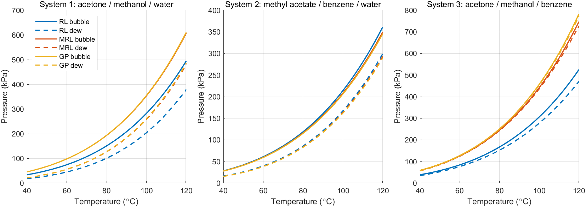
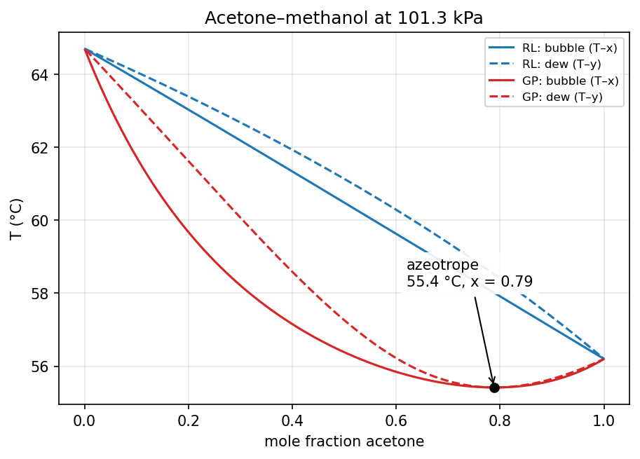

# Multicomponent Vapor–Liquid Equilibrium Solver

A MATLAB program for **n-component vapor–liquid equilibrium (VLE)** that computes:
- **bubble and dew pressures** at a given temperature,
- **bubble and dew temperatures** at a given pressure.

It supports three models of increasing rigor:
- **Raoult's law**
- **modified Raoult's law**, with **Wilson** activity coefficients
- the full **γ–Φ formulation**, which adds **virial-equation** fugacity coefficients

Components and parameters are read from data files, so the number of components is not fixed anywhere in the code.
A **Python / Jupyter** companion reproduces all results and adds the following:
- **flash calculations**
- a check of the model against the acetone–methanol azeotrope
- an analysis of where the model breaks down

*Course project – ChE 321 Chemical Engineering Thermodynamics, Boğaziçi University, Fall 2022. Group project with
Feriha Mesra Aktaş and Mustafa Matur.*



## Problem

Five components: **acetone, methanol, water, methyl acetate, benzene**. Three ternary systems were studied:

| System | Components |
|---|---|
| 1 | acetone / methanol / water |
| 2 | methyl acetate / benzene / water |
| 3 | acetone / methanol / benzene |

Each system was solved at three temperatures (70, 80, 90 °C) or pressures (150, 300, 450 kPa), and at three
compositions. With four calculation types and three models, that makes **180 cases**.

## Method

All three models share one equilibrium equation, y_i Φ_i P = x_i γ_i P_i^sat:

| Model | γ_i (liquid) | Φ_i (vapor) |
|---|---|---|
| Raoult's law (RL) | 1 | 1 |
| Modified Raoult's law (MRL) | Wilson equation | 1 |
| γ–Φ (GP) | Wilson equation | virial equation |

- **Vapor pressures** come from the Antoine equation.
- **Wilson activity coefficients** use Λ_ij = (V_j/V_i) exp(−a_ij/RT). The liquid volumes V come from the **Rackett**
  equation.
- **Fugacity coefficients** come from second virial coefficients, using the **Pitzer correlation** with standard mixing
  rules for the cross coefficients B_ij.
- **The four calculations** use the iterative algorithms of Smith, Van Ness & Abbott (§14.1). Dew-point calculations
  nest an inner loop on γ(x) inside an outer loop on P or T.

## Results (base composition 0.3 / 0.4 / 0.3; P at 70 °C, T at 150 kPa)

| System | Calculation | RL | MRL | γ–Φ |
|---|---|---:|---:|---:|
| 1 | Bubble P (kPa) | 106.74 | 138.74 | 138.77 |
| 1 | Dew P (kPa) | 68.01 | 85.06 | 85.44 |
| 1 | Bubble T (°C) | 79.92 | 72.31 | 72.30 |
| 1 | Dew T (°C) | 91.01 | 84.56 | 84.40 |
| 2 | Bubble P (kPa) | 85.83 | 84.03 | 83.48 |
| 2 | Dew P (kPa) | 59.02 | 57.37 | 57.09 |
| 2 | Bubble T (°C) | 87.67 | 88.51 | 88.79 |
| 2 | Dew T (°C) | 96.58 | 97.31 | 97.55 |
| 3 | Bubble P (kPa) | 119.47 | 176.85 | 180.06 |
| 3 | Dew P (kPa) | 108.96 | 175.40 | 178.88 |
| 3 | Bubble T (°C) | 76.78 | 65.15 | 64.70 |
| 3 | Dew T (°C) | 79.62 | 65.44 | 64.95 |

All 180 cases are in [`results/project_cases.csv`](results/project_cases.csv). The cleaned-up MATLAB code reproduces
the original submission in every case. The largest difference is 3 × 10⁻⁴, which comes from the original's looser
convergence tolerance. The Python port agrees with MATLAB to 10⁻¹⁴.

## Key findings

- **Liquid non-ideality dominates.** Going from Raoult's law to Wilson activity coefficients changes pressures by up
  to **61 %** and temperatures by up to **14 °C**. Adding vapor fugacity coefficients changes them by **less than 2 %**.
  At these pressures the vapor is nearly ideal, and modified Raoult's law is usually sufficient.
- **System 3 is nearly azeotropic.** With the non-ideal models, its bubble and dew curves almost coincide (see the
  figure above). Raoult's law misses this completely and underpredicts its pressure by about 35 %.
- **The model reproduces a real azeotrope.** For binary acetone–methanol at 1 atm, the γ–Φ model predicts a
  minimum-boiling azeotrope at **55.4 °C and 79 mol % acetone**. Literature values are about 55.5–55.7 °C at roughly
  80 mol %.
- **Flash calculations** (the assignment's bonus, added here in the notebook) work for all 15 conditions. At the mid
  temperature between the bubble and dew points, **55–81 %** of the feed vaporizes.
- **Know the model's limits.** Benzene and water are almost immiscible, with a real γ∞ of about 2400. With the given
  parameters, the Wilson equation predicts γ∞ ≈ 7. It cannot represent liquid–liquid splitting, so the **System 2**
  results describe a hypothetical single liquid phase. A real design would need a VLLE model such as NRTL or UNIQUAC.



## Repository structure

```
data/
  components.csv           Antoine constants, critical properties, acentric factors
  wilson_aij.csv           Wilson energy parameters a_ij (cal/mol)
matlab/
  vle_solver.m             interactive program
  run_project_cases.m      all 180 project cases + phase-envelope figure
  bubble_P.m, dew_P.m, bubble_T.m, dew_T.m, solve_vle.m
  wilson_gamma.m           activity coefficients
  virial_phi.m             fugacity-coefficient factor
  psat.m, tsat.m, converge_gamma.m, load_vle_data.m, select_components.m
  original_submission/     code as originally submitted
notebook/
  multicomponent_vle.ipynb Python port, flash calculations, azeotrope check, model limitations
results/
  project_cases.csv
figures/
```

## How to run

**MATLAB** (base MATLAB, no toolboxes):

```matlab
cd matlab
vle_solver           % interactive: choose calculation, model, components, composition, T or P
run_project_cases    % reproduce all project results
```

Example session:

```
Calculation:  1 => Bubble pressure ...                       Choice: 1
Formulation:  1 => Raoult's law  2 => Modified Raoult's law  3 => Gamma-phi   Choice: 3
Number of components (1-5): 3
Component 1: 1, x1 = 0.3   Component 2: 2, x2 = 0.4   Component 3: 3, x3 = 0.3
Temperature (degC): 70

BUBL P (GP) at T = 70 degC:  P = 138.7748 kPa
    component     x       y       gamma     Phi
    "acetone"    0.3    0.5124    1.5019   1.0059
    "methanol"   0.4    0.37575   1.0448   0.99675
    "water"      0.3    0.11186   1.6255   0.9819
```

To add a component, add a row to `data/components.csv` and a row and column to `data/wilson_aij.csv`.

**Python** (numpy, scipy, pandas, matplotlib):

```bash
jupyter notebook notebook/multicomponent_vle.ipynb
```

## Changes from the original submission

The original code (one main script and 29 small helper functions) is kept unchanged in `matlab/original_submission/`.
The cleaned-up version:

- **Shorter code.** The model is written as a few vectorized functions (Wilson, virial Φ, and the four solvers), and
  the main script is mostly input handling.
- **Mole-fraction check fixed.** The original compared `sum(x) ~= 1` exactly. Valid inputs such as
  0.1 + 0.2 + 0.7 add up to 1.0000000000000002 in floating point, so they were rejected. The check now uses a tolerance.
- **No hard-coded components.** The component menu and checks are built from the data file, as the assignment
  required. The original listed the five components explicitly.
- **Clearer data files.** The data files have named rows and columns. Each solver also reports γ and Φ and stops with
  a message if it fails to converge.

## Acknowledgments

The original analysis and MATLAB code were developed by our group for the course. I used Claude (Anthropic's AI
assistant) to help reorganize the code, write the Python companion notebook and draft this documentation.
